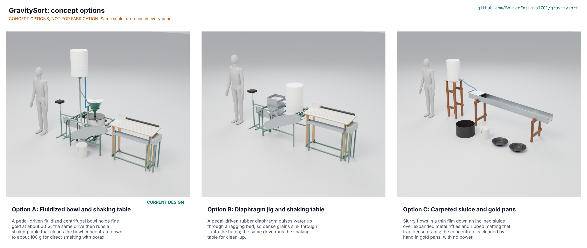

# GravitySort concept options

No pick: option C (carpeted sluice and gold pans) scores 172 of 230, option A (the current fluidized bowl and shaking table) 165 and option B (diaphragm jig and shaking table) 157, so all three are within 10 % of the top score and go to Amish without a recommendation (STANDARDS section 21; GVS-DDR-004, GVS-DEC-001 O1). The weighted table treats no requirement as a gate; on UR-003, the fine gold the project exists to catch, A scores 4, B 2 and C 1. Method: STANDARDS section 21.

*Figure 1. The three options rendered from their D3 models in `cad/src/model.py` (`components(option)`) by `python .kit/options.py`, with a 1.75 m person for scale. The picture is rendered with Blender on Amish's Mac and is not yet in the repository.*

## The options

### Option A: fluidized bowl and shaking table (current design)

Enhanced gravity: a pedal-driven fluidized centrifugal bowl holds fine gold at about 60 G, and the same drive then runs a shaking table that cleans the bowl concentrate to about 100 g for direct smelting with borax. This is the constructable design of GVS-DDR-003 with the decisions of 2026-10-02 and 2026-10-03 and the STEM fixes of 2026-10-25 (GVS-DEC-001 F1 to F5), described in GVS-PRC-001 and sized in GVS-CAL-001. Model: `cad/src/gvs_option_a.py`, every frame tube a 25 x 25 x 1.5 mm hollow section with its weld beads, every bolt, nut, washer, screw and pin with its hole. Key risks: fine-gold retention in the bed (STM S3), table ratio (S15), containment of a liner fragment (S10), liner casting and wear (S25, S29), mass at the 100 kg limit. Needs from a co-design partner: characterized ore for a recovery test, a PU casting shop, the site water supply.

### Option B: diaphragm jig and shaking table

A pulsed bed: an eccentric on the pedal jackshaft pushes a 3 mm EPDM diaphragm under the hutch 12 mm up and down about 240 times a minute, so water pulses up through a 40 mm ragging bed of steel shot on a punched screen; dense grains work down through the bed into the hutch and are drawn off at a spigot, and light gangue overflows a lip into a chute. The hutch concentrate is cleaned on the same shaking table as A, from the same pedal drive. The base frame, pedal station, jackshaft and the whole table group are A's parts and fixings; the jig (a 300 mm square screen box on two bearers across the top rails, a pyramid hutch to a 220 mm collar, flange ring, diaphragm, clamp ring and plates, connecting rod and clevis, valves, chute) and a 60 L drum on its own cradle are new. Model: `cad/src/gvs_option_b.py`. A first model with a 124 mm diaphragm gave only about 2 mm of water stroke over the bed; the modelled 190 mm plate in a 216 mm opening gives 5.7 mm (STM B1). Key risks: fine gold below about 0.1 mm is lost (B3), more water (B4), tens of kilograms of hutch product to clean on the table, and jigs want classified feed. Needs from a partner: a sized feed, ragging and water.

### Option C: carpeted sluice and gold pans

A flowing film: slurry runs down a 2.4 m galvanised sluice inclined at 1 in 12 over four sections of ribbed rubber matting held down by expanded metal riffle panels and bolted hold-down angles; a punched plate over the head box screens the feed, and a 60 L drum on a timber stand supplies the water. At clean-up the panels are lifted, the matting is washed into a tub and the concentrate is panned by hand in two gold pans; the panned concentrate goes into a lockable bucket. No power and no moving parts. Model: `cad/src/gvs_option_c.py` (sluice, matting, riffles, angles and bolts, two timber trestles with coach screws and bolts, drum stand, drum, valve, hose, tub, bucket with hasp, pans). Key risks: under 20 % recovery of gold finer than 100 um (C1), which is the gold the problem statement is about; 15 to 30 kg of concentrate to pan per shift (C3), the material miners amalgamate today; more water (C2). Needs from a partner: little beyond water and a site.

## First-order numbers

Table 1. Options compared. Costs for B and C are first-order estimates built from A's BOM rates, not priced BOMs; parts and mass are from `cad/fidelity.json` (model volumes, see the note).

| Quantity | Option A | Option B | Option C |
| --- | --- | --- | --- |
| Estimated parts cost (USD) | 594 (priced BOM) | about 400 (estimate) | about 195 (estimate) |
| Mass in the model (kg) | 116.4 | 118.5 | 88.5 |
| Throughput | 200 kg/h of feed time, 1.55 t per shift (CAL) | about 200 kg/h if the feed is classified (to confirm) | 200 kg/h or more |
| Fine-gold capture | Designed for 38 to 1,000 um (to test) | Poor below about 0.1 mm | Under 20 % below 0.1 mm |
| Energy or effort | 48 W at the pedals at 60 G; table about 15 W | About 15 W at the pedals; table about 15 W | None; water head only |
| Water | 1.19 m3/h | About 2.3 m3/h | About 2 m3/h or more |
| Parts count (D3 model) | 617 (180 made or bought, 311 fasteners, 126 welds) | 503 (128 made or bought, 283 fasteners, 92 welds) | 188 (45 made or bought, 136 fasteners, 7 welds) |
| STEM check | No outright fail; S10 and S33 fail with fixes that go to Amish; 8 rows to test or confirm | No fail (B1 to B4) | No fail; C3 plausible |

Mass note: the model masses come from part volumes and the kit's material densities. They include the motor option and the loose flush container (A), model bought parts such as the crankset, saddle, pulleys and pillow blocks as solid envelopes and draw perforated guards as plain sheet, so they read higher than the load-by-load estimate of GVS-CAL-001 (99.6 kg for A). They compare the options with each other, not with PR-011.

## Scoring

Table 2. Weighted scoring (weights: High UR 3, Medium 2, Low 1; scores 1 to 5).

| Criterion | Source | Weight | A | B | C | Reason |
| --- | --- | --- | --- | --- | --- | --- |
| UR-001 No mercury at any step | UR-001 | 3 | 5 | 5 | 3 | A and B end in a table concentrate of about 100 g for borax; C leaves 15 to 30 kg of sluice concentrate a shift, the material miners amalgamate today |
| UR-002 Keep up with about 1.5 t a day | UR-002 | 3 | 4 | 3 | 5 | A: 200 kg/h on paper; B: the jig wants narrow size fractions and the feed is unclassified below 2 mm; C: a 300 mm sluice takes 200 kg/h easily |
| UR-003 Catch the fine gold sluices lose | UR-003 | 3 | 4 | 2 | 1 | Centrifuges concentrate very fine gold; jigs are not efficient for fine gold; sluices hold under 20 % below 100 um (STM S3, B3, C1) |
| UR-004 Smeltable concentrate, about 100 g | UR-004 | 3 | 4 | 2 | 2 | A: 5.3 kg to the table; B: a jig hutch product of a few percent sends tens of kilograms to the table; C: tens of kilograms panned by hand |
| UR-005 Runs without grid power | UR-005 | 3 | 4 | 5 | 5 | A 48 W at the pedals at 60 G; B about 15 W; C needs only water head |
| UR-006 Motor where power exists | UR-006 | 2 | 5 | 4 | 3 | A: MotionCore option designed in; B: the same jackshaft could take it, not designed; C: nothing to drive |
| UR-007 Little and silty water | UR-007 | 3 | 4 | 2 | 2 | A 1.19 m3/h with a filter; B about 2.3 m3/h; C about 2 m3/h at 10 % solids and much more in practice |
| UR-008 Affordable | UR-008 | 3 | 2 | 3 | 5 | A $594 (BOM); B about $400; C about $195 (estimates) |
| UR-009 Built and repaired locally, no lathe | UR-009 | 3 | 3 | 4 | 5 | A needs a cast PU liner, a rotary union and a bevel gearbox; B is sheet metal and a rubber diaphragm; C is folded sheet and timber |
| UR-010 Carried to site by two people | UR-010 | 2 | 3 | 3 | 4 | A 99.6 kg (0.4 kg margin); B of similar size; C is light but long (2.4 m channel) |
| UR-011 Safe to run | UR-011 | 3 | 3 | 4 | 5 | A has a spinning bowl, a tall full tank and open containment (PR-016); B moves slowly; C has no moving parts |
| UR-012 Quick, secure clean-up | UR-012 | 3 | 4 | 3 | 2 | A: toolless flush into a locked pail; B: spigot draw-off of a larger mass; C: matting washed and panned in the open |
| UR-013 Wear parts replaceable on site | UR-013 | 2 | 3 | 4 | 4 | A: liner life unknown; B: diaphragm and ragging are cheap; C: matting is cheap |
| UR-014 Speed and settings shown | UR-014 | 2 | 5 | 3 | 3 | A has a speed display; B and C are set by eye |
| Cost against the value-engineering target | GVS-MKT-001 | 2 | 2 | 3 | 5 | A is USD 139 over the $455 target; B and C are under it |
| Buildable with local skills and tools | GVS-BLD-001 | 2 | 3 | 4 | 5 | As UR-009 |
| Safety | GVS-RSK-001 | 3 | 3 | 4 | 5 | As UR-011; A's residual risks are the bowl and the tank |
| Maintenance | GVS-RSK-001 | 1 | 3 | 4 | 4 | A has the most parts to maintain |
| **Weighted total** | | | **165** | **157** | **172** | Maximum 230 |

## Recommendation

None: the three totals lie within 10 % of each other (A is 4.1 % and B 8.7 % below C), so under STANDARDS section 21 the choice goes to Amish without a pick, recorded as Proposed, awaiting Amish in GVS-DEC-001 (O1) and argued in GVS-DDR-004. Under section 21 the current design A stays in the repo unless Amish decides otherwise.

For the decision: C leads only because it is cheap, simple and safe, and those qualities are counted twice (as user requirements and as the section 21 criteria). It scores 1 on UR-003 and 2 on UR-004, and its large hand-panned concentrate is where mercury use tends to return. If Amish treats UR-003 as a gate (a score of 3 or more), only A passes. The best idea to graft from the runners-up whatever is chosen: C's carpeted sluice as a cheap, unpowered scavenger under A's tailings outlet, which would also catch coarse gold during upsets.
